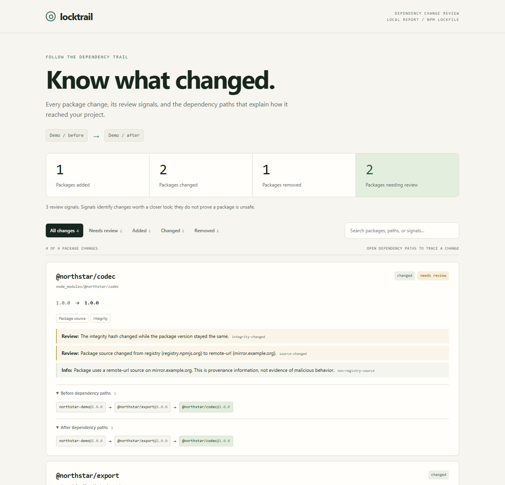

# Locktrail

**Your lockfile changed. Follow the dependency trail.**

Turn an npm lockfile diff into a readable review: what changed, which dependency
paths lead to it, and which metadata changes deserve a closer look.

Local CLI · portable HTML · JSON and Markdown · zero dependencies · MIT

[**Open the interactive demo**](https://lukaluka3.github.io/locktrail/) ·
[Quick start](#try-it-in-30-seconds) · [How it was tested](docs/VALIDATION.md)



## Try it in 30 seconds

Requires **Node.js 20+** and npm. Try the pinned GitHub release without cloning
this repository or installing a global command:

```sh
npm exec --yes --ignore-scripts --package=https://github.com/lukaluka3/locktrail/releases/download/v0.1.0/locktrail-0.1.0.tgz -- locktrail demo
```

The demo uses invented packages and the real analysis engine. Add
`--format html --output report.html` and open `report.html` in your browser for
search, filters and dependency paths. Downloading the release needs a connection;
the analysis itself runs offline. The release includes a SHA-256 checksum.

This is an **early 0.1.0 preview**, distributed through GitHub Releases. It has not
been published to the npm registry. `npm exec` above uses the explicit release
URL, not an npm package with the same name.

## Run on your repository

Open a terminal **in your own npm project's Git repository**. Choose the comparison
that matches your changes; Git and the named refs must be available locally.

**Review a committed dependency-update branch against main:**

```sh
npm exec --yes --ignore-scripts --package=https://github.com/lukaluka3/locktrail/releases/download/v0.1.0/locktrail-0.1.0.tgz -- locktrail --base origin/main --head HEAD --merge-base --format html --output locktrail-review.html
```

Replace `origin/main` with your project's base branch if different. **Review
uncommitted changes to your lockfile instead:**

```sh
npm exec --yes --ignore-scripts --package=https://github.com/lukaluka3/locktrail/releases/download/v0.1.0/locktrail-0.1.0.tgz -- locktrail --base HEAD --format html --output locktrail-review.html
```

Open `locktrail-review.html`. It stays on your machine; no account or upload is
required. If that file already exists, choose another output name. Comparing
against `HEAD` after committing your changes correctly produces an empty report;
use the branch comparison above for a committed update.

For repeated use, you can install that same GitHub release globally:

```sh
npm install --global --ignore-scripts https://github.com/lukaluka3/locktrail/releases/download/v0.1.0/locktrail-0.1.0.tgz
locktrail --help
```

## The question a raw diff misses

A direct dependency update can change packages several levels down the tree.
Locktrail puts the changed location and its dependency paths together:

```text
ADDED @northstar/native  — → 1.0.0
  Location: node_modules/@northstar/native
  Review: The lockfile now declares an install script.
  After: northstar-demo@1.0.0 → @northstar/export@2.0.0 → @northstar/native@1.0.0
```

The example is synthetic. An install-script flag is a reason to inspect a package;
it does not establish that the package is unsafe. Locktrail never installs the
target project's dependencies or runs their code.

## More commands

These shorter commands assume you installed `locktrail` as above. Run Git
comparisons from your own project, or specify it with `--repo`.

```sh
# Two local lockfiles
locktrail diff old-package-lock.json package-lock.json

# Compare the current lockfile to its committed version
locktrail --base HEAD

# Review a branch relative to its common ancestor with main
locktrail --base origin/main --head HEAD --merge-base

# Run from another directory or select a nested lockfile
locktrail --repo ../my-app --base HEAD --lockfile apps/web/package-lock.json

# Export an offline report, JSON, or a CI summary
locktrail --base HEAD --format html --output review.html
locktrail --base HEAD --format json
locktrail --base HEAD --format markdown

# Opt into failing CI when a review signal exists
locktrail --base origin/main --head HEAD --merge-base --fail-on review
```

Git comparisons use local refs and never fetch, checkout, or modify your project.
Without `--head`, the after input is your working lockfile, including uncommitted
changes. With `--head`, both inputs come from commits. Paths are relative to the
repository root. The chosen lockfile must exist on both sides.

`--output` creates a new file and refuses to overwrite an existing one. Default
output goes to stdout; progress and errors go to stderr.

## What it reports

| Change | Treatment |
| --- | --- |
| Added or removed package location | Version and dependency paths |
| Updated version or supported metadata | Changed fields and before/after paths |
| Newly recorded install-script flag | Review signal |
| Integrity changed or removed at the same version | Review signal |
| Download host or source kind changed | Review signal |
| Git, local, HTTP, or other remote source introduced | Information |
| Major version changed | Information |

Separate nested copies remain separate. Workspace links, scoped packages, npm
aliases and peer/optional declarations participate in the graph. Removed packages
show **before** paths; additions show **after** paths; changed packages can show
both. At most three paths per side are shown, with explicit limits and warnings.

Exit codes: **0** = report produced; **1** = a review signal with `--fail-on review`;
**2** = invalid input, unsupported format, Git failure or another error. An exit
code of 0 is not a package safety verdict.

## Supported scope and limits

- **npm `package-lock.json` v2 and v3 only.** npm v1, pnpm, Yarn, Bun and other
  formats are not supported in this release.
- Compares package installation **locations**. A moved or deduplicated package
  can appear as a removal and addition. The root project's own metadata is not
  counted as a dependency change.
- Trails describe declared graph reachability. They do not prove why npm selected
  a version, validate semver ranges, or model the packages actually installed on a
  particular operating system. Local package records are treated as workspace
  entry points. Missing optional dependencies do not produce warnings.
- Compares names, versions, sources, integrity, install-script and dependency-type
  flags, license, dependency maps, peer optional metadata, engines, OS and CPU.
  It does not compare arbitrary unknown fields or package contents.
- Private registries may be described as remote sources. This is provenance
  information. A lockfile cannot tell us the contents of lifecycle scripts or
  whether a dependency has a known vulnerability.
- Inputs are limited to 20 MiB each through the CLI. Graph traversal is bounded,
  and reports share a 100,000-step dependency-path output budget;
  unresolved or incomplete paths are reported. The tool does not hide invalid
  input behind a successful empty report.
- Reports may contain private package names and paths. CLI JSON redacts URL
  credentials, queries and fragments in source/spec fields, but is not a general
  secret scrubber. [Privacy and security](SECURITY.md).

## Library

From this checkout, or after installing a local packed artifact:

```js
import { analyze, renderMarkdown } from './src/index.mjs';

const report = analyze(beforeLockObject, afterLockObject);
console.log(renderMarkdown(report));
```

`analyze()` is deterministic, performs no I/O, and does not mutate its inputs.
It returns `{ schemaVersion, summary, changes, warnings }`. Each change includes
its package location, snapshots, changed fields, dependency paths and findings.
The raw library return value preserves input metadata, including URLs; sanitize
it before sharing. The report schema may evolve before 1.0.

## Use in a team

Start with the Markdown report in a CI job summary and review a few normal updates
before enabling `--fail-on review`. See the [CI recipe](docs/CI.md).

Other tools may fit your needs better: [lockdelta](https://github.com/lachaib/lockdelta)
and [git-pkgs](https://github.com/git-pkgs/git-pkgs) cover broader dependency
workflows; [lockdiff](https://github.com/aaaaorg/lockdiff) provides readable npm
diffs; [npm-script-lens](https://github.com/Booyaka101/npm-script-lens) inspects
install scripts. Locktrail explores a focused, offline review built around
dependency paths. The [research notes](docs/RESEARCH.md) discuss close competitors
and the assumptions we still need to validate.

## Development

```sh
git clone https://github.com/lukaluka3/locktrail.git
cd locktrail
npm run check
npm pack --dry-run
```

No dependency installation or build step is needed for the CLI. The initial CI run
passed on Node 20/22/24 across Linux, macOS and Windows. `npm run build:demo`
regenerates the hosted synthetic demo from the same engine. See [validation evidence](docs/VALIDATION.md),
[contributing](CONTRIBUTING.md), and the [roadmap](docs/ROADMAP.md).

If a dependency path looks wrong, a small before/after fixture makes a great
issue. Please remove private names and credentials before sharing it.
